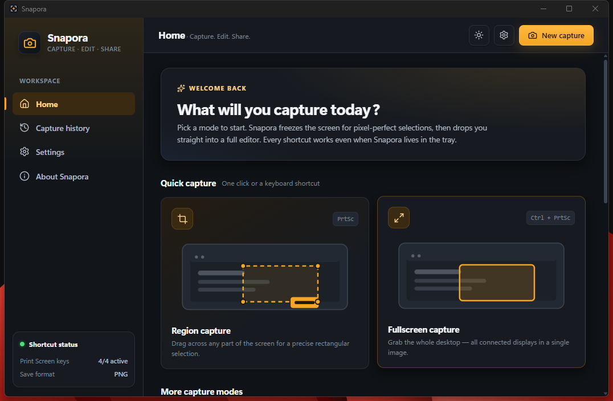
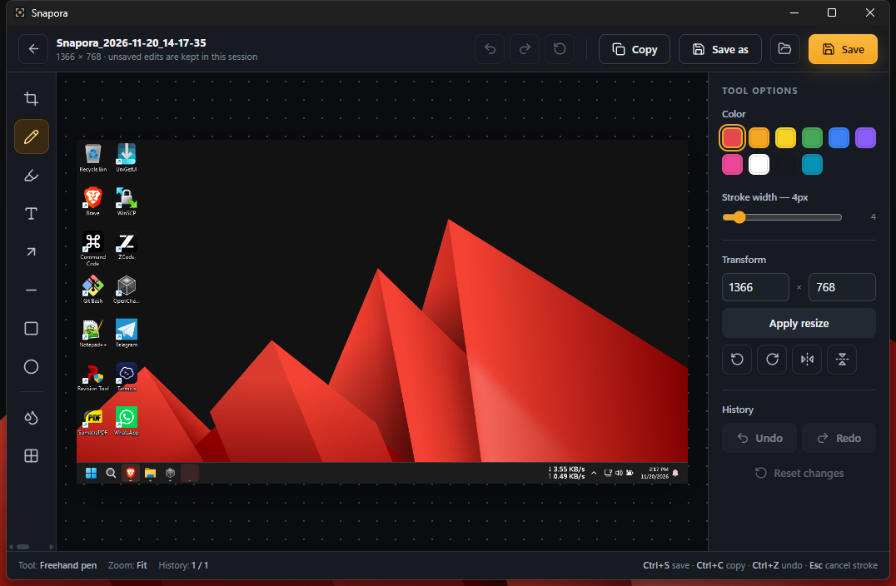
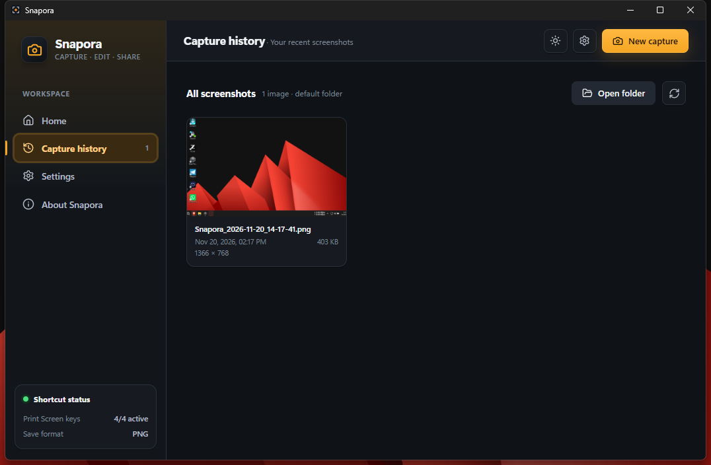
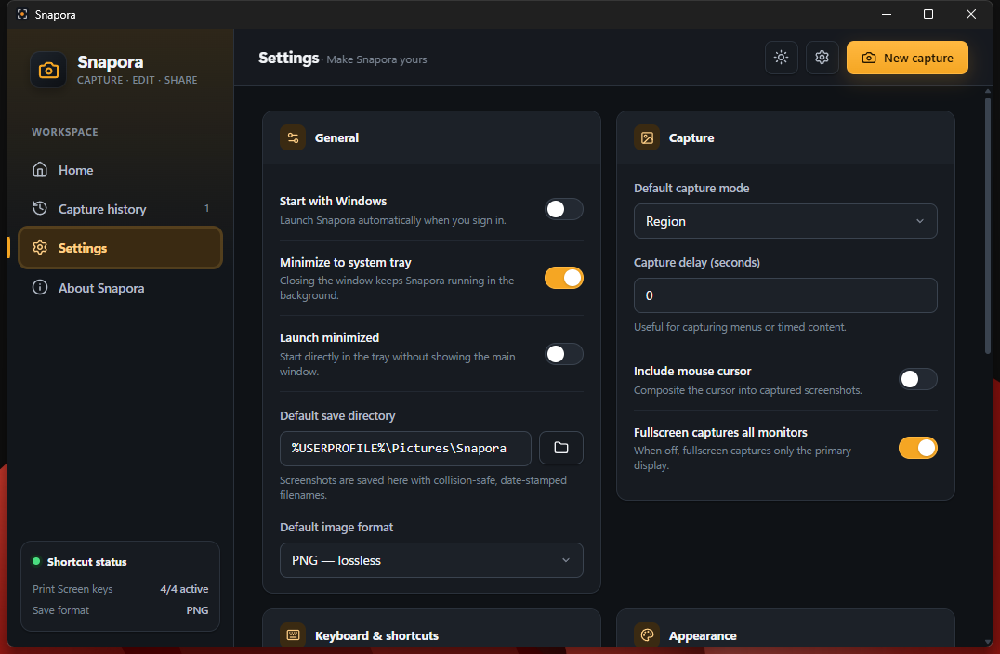
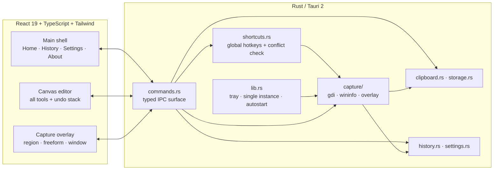

<div align="center">


# Snapora

### **Capture. Edit. Share.**

A fast, focused screenshot application for Windows 10 & 11 — built with Rust, Tauri 2 and React.

[](https://github.com/Kaziopu5938/Snapora/releases)
[](https://www.microsoft.com/windows)
[](#architecture)
[](LICENSE)
[](#verification)

</div>

---

## A real desktop utility, not a web app

Snapora uses native Windows APIs (GDI, DWM, `SHFileOperation`, the Windows clipboard) behind a
polished Tauri + React interface. It stays in the system tray, listens for Print Screen globally,
freezes the desktop for pixel-perfect selections, and drops you straight into a full image editor.

<div align="center">

| Home | Editor |
| :---: | :---: |
|  |  |

| History | Settings |
| :---: | :---: |
|  |  |

</div>

---

## Features

| | Feature | What it does |
| :---: | --- | --- |
| 🖥️ | **7 capture modes** | Region, freeform lasso, window pick, active window, fullscreen, single monitor, all monitors |
| ⌨️ | **Global Print Screen** | Works from any app and while minimized to the tray, with honest conflict detection |
| ✏️ | **Full editor** | Crop, resize, rotate, flip, pen, text, arrows, lines, rectangles, ellipses, highlighter, blur, pixelate, undo/redo/reset |
| 📋 | **Native clipboard** | Paste screenshots into Word, Paint, Discord, Teams, email — real CF_DIB bitmaps |
| 💾 | **Flexible saving** | PNG / JPEG / WebP, collision-safe date-stamped filenames, custom save folder, Save As |
| 🖼️ | **History** | Thumbnails, metadata, open in editor, copy, delete to Recycle Bin, reveal in Explorer |
| 🔔 | **System tray** | Close-to-tray, quick captures, open folder, exit; optional start with Windows |
| 🎨 | **Light & dark** | Follow Windows automatically or pick a theme; the window frame follows too |
| ⚙️ | **Persistent settings** | Everything remembered across restarts, including shortcut registration status |

---

## Capture shortcuts

These are **global** — they work even when Snapora is in the tray.

| Shortcut | Capture mode |
| --- | --- |
| `PrtSc` | Region selection |
| `Alt` + `PrtSc` | Active window |
| `Ctrl` + `PrtSc` | Fullscreen |
| `Shift` + `PrtSc` | Freeform lasso |
| `Esc` | Cancel the capture |

Inside the editor: `Ctrl+S` save · `Ctrl+C` copy · `Ctrl+Z` undo · `Ctrl+Y` redo.

> **Windows 11 note.** Windows can reserve `PrtSc` for Snipping Tool. Snapora reads the registry
> setting and shows the real registration status in **Settings → Keyboard**, with a one-click link
> to the Windows setting. It never claims a shortcut works when registration was blocked.

---

## Install

Download [`Snapora_x64.msi`](release/Snapora_x64.msi) and run it — no administrator rights required.
It creates Start Menu and desktop shortcuts and uninstalls cleanly while **preserving your
screenshots and settings**.

Prefer portable? Copy [`Snapora.exe`](release/Snapora.exe) and `WebView2Loader.dll` together into
any folder and run the EXE.

<details>
<summary><b>Build prerequisites and commands</b></summary>

See [BUILD.md](BUILD.md) for the full guide, including the GNU/w64devkit fallback used to produce
these binaries.

```powershell
npm install
npm run tauri dev                 # development
powershell -File scripts\build-release.ps1   # production EXE + MSI
```

</details>

---

## Architecture



The save folder is the source of truth for history — only metadata is kept in the UI. Shot filenames
look like `Snapora_2026-11-20_00-06-12.png`. See [docs/ARCHITECTURE.md](docs/ARCHITECTURE.md) for the
module-by-module breakdown.

---

## Documentation

- [Changelog](CHANGELOG.md) — what changed in each version
- [Architecture](docs/ARCHITECTURE.md) — modules, data flow, DPI/coordinate model
- [Build & verification guide](BUILD.md) — prerequisites, release workflow, manual test checklist
- [MIT License](LICENSE)

---

## Verification

This release was built and exercised on a real Windows host:

- `tsc --noEmit` + Vite production build, `cargo check` / `cargo build` — clean, zero warnings.
- Release EXE and MSI generated; MSI database inspected (Start Menu, desktop, uninstall shortcuts).
- Global `Ctrl+PrtSc` produced a real 1366×768 screenshot; editor rotate/undo, PNG/JPEG/WebP saving,
  `Ctrl+S`, `Ctrl+C` to the Windows clipboard, and settings persistence were all verified live.
- App launches at roughly 23 MB working set.
- v1.0.2: the main window stays inside the work area; Windows' Print Screen snipping shortcut is
  disabled on launch (toggleable in Settings); a capture from a minimized window restores the window
  straight into the editor, not Home.

Features that need a human at the desktop (visual review on scaled displays, pasting into Word /
Discord / Teams, installer UI flow) are listed in the [manual checklist](BUILD.md#manual-verification-checklist).

---

## Limitations

- Interactive selections operate per monitor; use **Fullscreen** or **All monitors** for one image
  spanning multiple displays.
- Windows 11 may hand `PrtSc` to Snipping Tool first — disable that Windows setting if Snapora
  reports a conflict.
- Global shortcuts are reserved at launch; changing them in Settings re-registers immediately.

---

<div align="center">

MIT © 2026 Snapora Project · *Capture. Edit. Share.*

</div>
