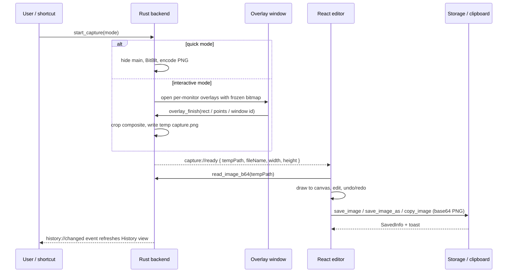

# Architecture

Snapora is split into a thin React presentation layer and a Rust/Tauri backend that owns every
operation touching Windows. The webview never reads arbitrary files or calls Windows APIs directly —
it goes through the typed command surface in `src-tauri/src/commands.rs`.

## Backend modules (`src-tauri/src/`)

| Module | Responsibility |
| --- | --- |
| `capture/gdi.rs` | Monitor enumeration with DPI, `BitBlt` capture of the virtual desktop / rects, cursor compositing, DIB section management |
| `capture/wininfo.rs` | Enumeration of visible top-level windows (cloaked/tool windows filtered), `PrintWindow` capture with a `BitBlt` fallback |
| `capture/overlay.rs` | Interactive capture sessions: freeze the desktop, create one frameless always-on-top window per monitor, crop the composite into the final image (including the supersampled alpha mask for freeform selections) |
| `capture/mod.rs` | Capture orchestration, busy guard, `capture://ready` / `capture://error` events |
| `shortcuts.rs` | Print Screen family registration, dispatch, and registry-based Snipping Tool conflict detection |
| `clipboard.rs` | `arboard`-based CF_DIB clipboard writing (works with Word, Paint, Discord, Teams, mail clients) |
| `storage.rs` | Default folder resolution, collision-safe filenames, PNG/JPEG/WebP encoding |
| `history.rs` | Directory scan for metadata, cached 320 px thumbnails, Recycle Bin deletion via `SHFileOperationW` |
| `settings.rs` | Persisted JSON model (general, capture, keyboard, appearance) |
| `commands.rs` | All `#[tauri::command]` handlers — the IPC contract with the frontend |
| `lib.rs` | Plugin setup, state, tray menu, single-instance handling, close-to-tray, startup theme |

## Frontend (`src/`)

| Path | Responsibility |
| --- | --- |
| `lib/api.ts` | Typed `invoke` wrappers and event listeners |
| `lib/types.ts` | TypeScript mirrors of the Rust serde shapes |
| `components/ui.tsx` | Design-system primitives: toggle, panel, modal, toast host |
| `main/` | Shell, sidebar, Home, History, Settings, About views |
| `editor/Editor.tsx` | Canvas editor. Tools paint onto the real bitmap; an undo stack stores PNG data URLs (capped at 16 states) |
| `overlay/OverlayApp.tsx` | Region/freeform/window-pick UI inside the capture windows |

The same React bundle serves both the main window and the overlay windows; `App.tsx` picks the right
root by inspecting the current window label (`overlay-*` → `OverlayApp`).

## Coordinate and DPI model

Windows reports monitor bounds in **physical pixels**. Overlay windows are created with
`PhysicalPosition` / `PhysicalSize` and display a per-monitor bitmap cropped from the frozen composite.
The UI maps pointer coordinates back to global physical pixels with:

```
scaleX = bitmap.naturalWidth  / displayedWidth
scaleY = bitmap.naturalHeight / displayedHeight
globalX = monitor.x + cssX * scaleX
```

That ratio automatically accounts for the webview's device pixel ratio and any display scaling
(125 %, 150 %, …), so selections line up with the frozen desktop on mixed-DPI setups.

## Data flow: capture → editor → save



## Design decisions

- **rlib only.** `Cargo.toml` declares `crate-type = ["rlib"]` because this is a desktop-only app;
  the Tauri default `cdylib` produces an export table GNU `ld` rejects.
- **Base64 image loading.** The editor reads images through `read_image_b64` instead of the asset
  protocol so the canvas is never tainted and custom save folders outside the asset scope still work.
- **No database.** The save directory is the history source of truth; thumbnails are a disposable
  cache in app-local data.
- **Honest shortcut status.** Registration results and the Windows Snipping Tool registry value are
  surfaced to the UI instead of being silently ignored.
